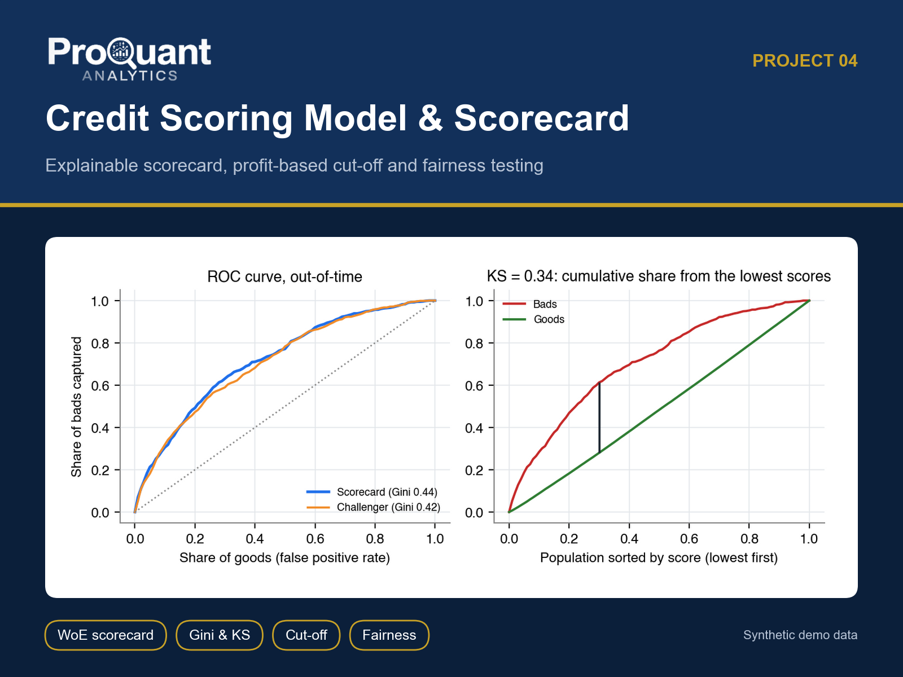
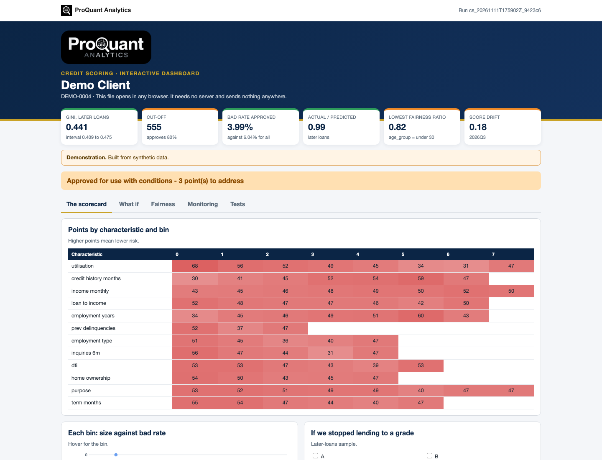
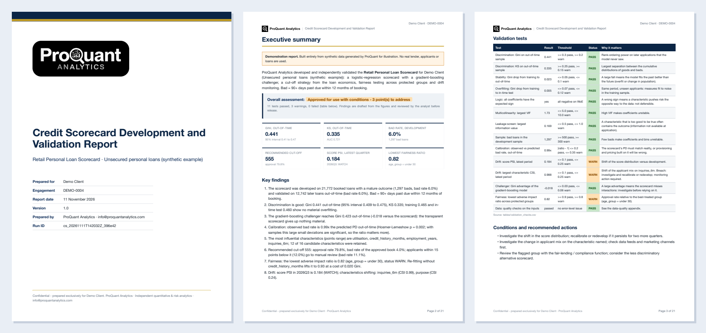
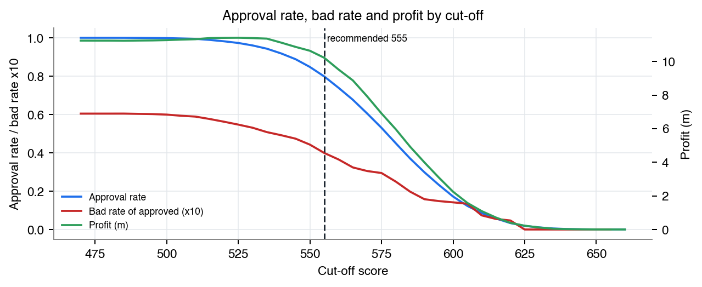
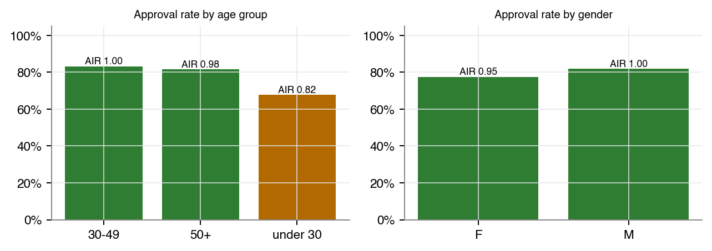
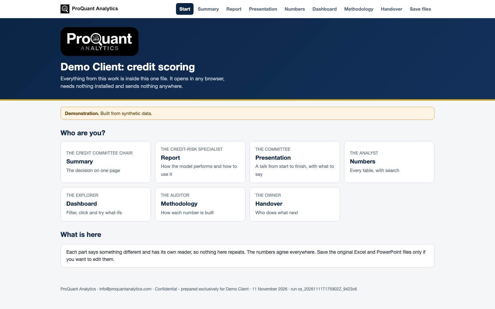

# Credit Scoring Model & Scorecard

**An explainable retail credit scorecard with a profit-based cut-off, fairness testing and monitoring.**

  

> **Showcase repository.** It shows the method and the actual files a client receives, built on **synthetic demo data** (a fictional *Demo Client*). The numbers below are illustrative, not client results. The production code is proprietary and is not published here.

## Contents

- [Business problem](#business-problem)
- [Approach](#approach)
- [Results (demo)](#results-demo)
- [Deliverables](#deliverables)
- [Gallery](#gallery)
- [Tech stack](#tech-stack)
- [How to view it](#how-to-view-it)
- [How an engagement works](#how-an-engagement-works)

## Business problem

Many lenders approve with rules of thumb or a vendor score nobody can explain. Models drift, approval rates move with an unreviewed cut-off, and boards and regulators ask for documented development, validation, fairness evidence and monitoring.

**Typical clients:** Banks, microfinance institutions, consumer lenders, BNPL fintechs and credit unions.

## Approach

- Outcome definition, approval funnel and development / test / out-of-time samples
- Weight-of-evidence binning and information value; logistic regression scaled to points with reason codes
- Validation: AUC, Gini with bootstrap interval, KS, lift and calibration; gradient-boosting challenger
- Profit-maximising cut-off within the bad-rate appetite; risk grades A-E and a refer zone
- Fairness by group (approval rate, adverse impact ratio, error rates) and a less-discriminatory alternative search
- Monitoring with PSI / CSI by quarter; a self-tested scoring pack for production

## Results (demo)

**Overall opinion on the demo data:** Approved for use with conditions - 3 point(s) to address

| Measure | Value | Context |
|---|---:|---|
| Gini, later loans | **0.441** | interval 0.409 to 0.475 |
| Cut-off | **555** | approves 80% |
| Bad rate approved | **3.99%** | against 6.04% for all |
| Actual / predicted | **0.99** | later loans |
| Lowest fairness ratio | **0.82** | age_group = under 30 |
| Score drift | **0.18** | 2026Q3 |

<em>The interactive dashboard (one HTML file: The scorecard, What if, Fairness, Monitoring, Tests). <a href="https://abduwars.github.io/proquant-04-credit-scoring/sample-delivery/09_DemoClient_CreditScoring_Dashboard_v1.0_20261111.html">Open it live</a>.</em>

## Deliverables

Everything opens from **one file**, *Start here* (no. 1), in any browser: pick your role, read each document, watch the presentation, search the tables and use the dashboard. Each document has one reader and one job, and the numbers agree across all of them. PowerPoint and Excel files open in the browser through Microsoft's free online viewer; *download* gives the original file.

| # | File | Format | What it is |
|---|---|---|---|
| 1 | [Start here](https://abduwars.github.io/proquant-04-credit-scoring/sample-delivery/00_START_HERE_DemoClient.html) | HTML (opens in any browser) | **One file that holds it all**: every document, the presentation, the tables and the dashboard |
| 2 | [Report](sample-delivery/01_DemoClient_CreditScoring_Report_v1.0_20261111.pdf) | PDF | Development and validation report (~22 pages) |
| 3 | [Summary](sample-delivery/02_DemoClient_CreditScoring_Summary_v1.0_20261111.pdf) | PDF | One page: the decision, with no charts |
| 4 | [Presentation](https://view.officeapps.live.com/op/view.aspx?src=https%3A%2F%2Fabduwars.github.io%2Fproquant-04-credit-scoring%2Fsample-delivery%2F03_DemoClient_CreditScoring_Presentation_v1.0_20261111.pptx) | PowerPoint · [download](https://raw.githubusercontent.com/AbduWars/proquant-04-credit-scoring/main/sample-delivery/03_DemoClient_CreditScoring_Presentation_v1.0_20261111.pptx) | **A full talk**: 14 slides with editable charts and speaker notes, ready to present |
| 5 | [Results Workbook](https://view.officeapps.live.com/op/view.aspx?src=https%3A%2F%2Fabduwars.github.io%2Fproquant-04-credit-scoring%2Fsample-delivery%2F04_DemoClient_CreditScoring_ResultsWorkbook_v1.0_20261111.xlsx) | Excel · [download](https://raw.githubusercontent.com/AbduWars/proquant-04-credit-scoring/main/sample-delivery/04_DemoClient_CreditScoring_ResultsWorkbook_v1.0_20261111.xlsx) | **The working file**: a Control panel with live formulas, and every table. Opens on a **Read me** sheet with a linked index |
| 6 | [Methodology](sample-delivery/05_DemoClient_CreditScoring_Methodology_v1.0_20261111.pdf) | PDF | Model documentation for model risk, audit and the regulator |
| 7 | [Handover Note](sample-delivery/06_DemoClient_CreditScoring_HandoverNote_v1.0_20261111.pdf) | PDF | What was delivered, conditions, assumptions, go-live and monitoring |
| 8 | [Scoring Calculator](https://abduwars.github.io/proquant-04-credit-scoring/sample-delivery/08_DemoClient_CreditScoring_ScoringCalculator_v1.0_20261111.html) | HTML (opens in any browser) | **Scoring calculator**: one self-contained page where the credit team scores an applicant, sees the decision and the reasons |
| 9 | [Dashboard](https://abduwars.github.io/proquant-04-credit-scoring/sample-delivery/09_DemoClient_CreditScoring_Dashboard_v1.0_20261111.html) | HTML (opens in any browser) | **Interactive dashboard in one file**: opens in any browser, explores the data, tries what-ifs and reads the updated tracker |

**Delivered to clients only, not in this showcase:** scoring pack (scorecard JSON, Python scorer, SQL, test cases).

Also delivered: data-quality reports and long-format CSV / Parquet exports for Power BI or Looker Studio.

<em>The first pages of the PDF report.</em>

## Gallery

<table><tr>
<td width="50%"></td>
<td width="50%"></td>
</tr></table>

<em>The start page: one file, one click, nothing to install.</em>

## Tech stack

Python · pandas · NumPy · matplotlib · Jinja2 + WeasyPrint (PDF) · openpyxl (Excel) · python-pptx (PowerPoint) · pydantic · pytest · scikit-learn · statsmodels · SciPy

Every run is reproducible and audited: data fingerprints, configuration and code version are recorded, data-quality checks run before any calculation, and an automated test suite checks every deliverable (including opening the decks and workbooks in Microsoft Office).

## How to view it

1. **In the browser (nothing to install):** open the [live start page](https://abduwars.github.io/proquant-04-credit-scoring/sample-delivery/00_START_HERE_DemoClient.html) or the [dashboard](https://abduwars.github.io/proquant-04-credit-scoring/sample-delivery/09_DemoClient_CreditScoring_Dashboard_v1.0_20261111.html).
2. **Download:** click any PDF, Excel or PowerPoint file in the table above, or clone the repository: `git clone https://github.com/AbduWars/proquant-04-credit-scoring.git`.
3. **On your own data:** this is delivered as a fixed-scope engagement. Write to [info@proquantanalytics.com](mailto:info@proquantanalytics.com).

## How an engagement works

| Step | What happens |
|---|---|
| 1. Discovery call | Your question, your data and the decision the work must support |
| 2. Scope and NDA | Fixed scope, timeline and thresholds agreed **before** any result is seen |
| 3. Data request | A precise list of files or read-only access; personal data pseudonymised |
| 4. Build and interim update | First results, open questions and data issues, early |
| 5. Delivery | The full package above, on your data, with a walk-through |
| 6. Handover | Methodology, runbook where relevant, and optional monthly refresh |

---

<b>ProQuant Analytics</b> · Quant & risk analytics, business analytics, data engineering and AI automation Rotterdam, NL · remote-first <a href="https://www.proquant-analytics.com">www.proquant-analytics.com</a> · <a href="mailto:info@proquantanalytics.com">info@proquantanalytics.com</a> · <a href="https://github.com/AbduWars">All 13 projects</a>

© 2026 ProQuant Analytics. Sample outputs on synthetic data, shown for demonstration. All rights reserved.

